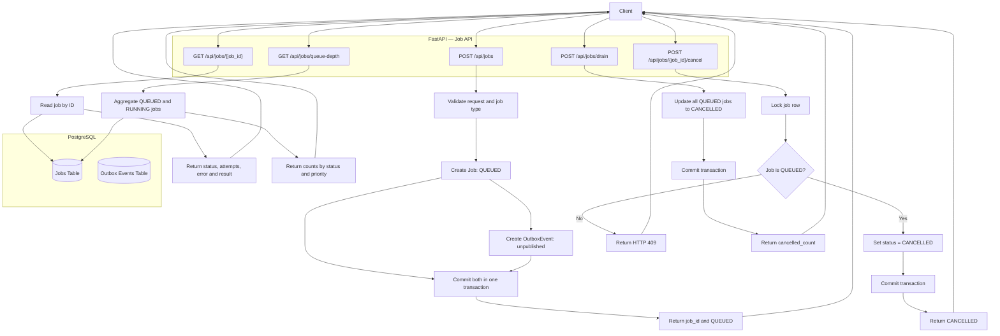
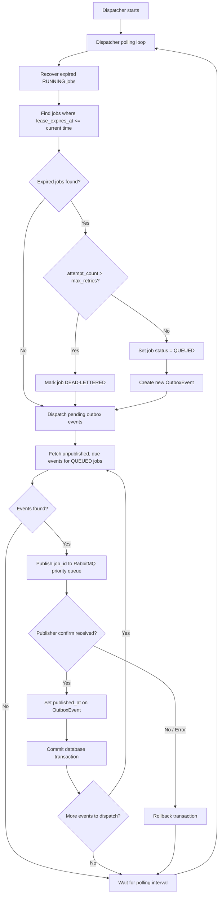
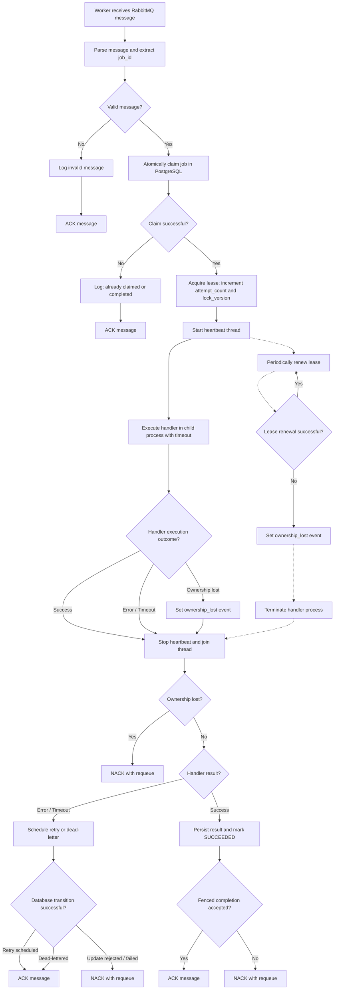

## Architecture

### 1. Job API — Submission and Management

The Job API accepts jobs, persists job and outbox records
atomically, and exposes operational endpoints.

### 2. Dispatcher — Recovery and Message Publishing

The dispatcher runs in a polling loop and performs two responsibilities:

- Recovers jobs whose worker leases have expired.
- Publishes due, unpublished outbox events to the RabbitMQ priority queue.

### 3. Worker Pool — Job Execution and Retry

The Worker Pool consumes jobs from the RabbitMQ priority queue and atomically claims them in PostgreSQL using leases and fencing tokens.

Each worker executes the registered job handler in a separate process while a heartbeat thread periodically renews the lease.

On successful execution, the worker persists the result and marks the job as SUCCEEDED. On handler failure or timeout, it schedules a retry with exponential backoff or marks the job as DEAD-LETTERED when retries are exhausted.

If ownership is lost, the worker terminates handler execution and requeues the message. RabbitMQ messages are acknowledged only after the corresponding database state transition succeeds.

