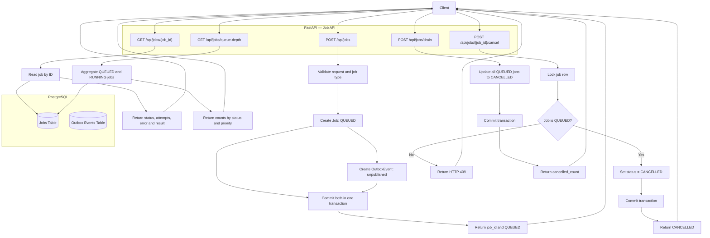
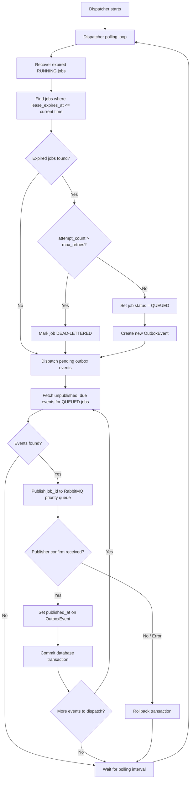
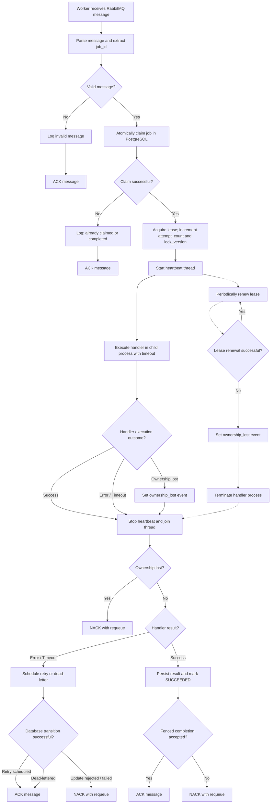

# Async Job Processing Service

An asynchronous job processing service built with FastAPI, PostgreSQL, RabbitMQ and Python workers.

## Prerequisites

Make sure the following are installed:

- Python 3.x
- PostgreSQL
- RabbitMQ

  Run below commands in RabbitMQ CLI

  sudo rabbitmqctl add_user USERNAME PASSWORD

  sudo rabbitmqctl add_vhost jobs

  sudo rabbitmqctl set_permissions -p jobs USERNAME ".\*" ".\_" ".\*"

  sudo rabbitmqctl set_user_tags USERNAME management

  curl -i -u USERNAME:<password> -H "content-type: application/json" -X PUT -d '{"durable":true,"auto_delete":false,"arguments":{"x-max-priority":10}}' http://PUBLIC_IP_OF_RABBITMQ:15672/api/queues/jobs/jobs_priority

- Git

## Setup and Installation

### 1. Clone the repository

```bash
git clone <your-repository-url>
cd Async-Job-Processing-App
```

### 2. Create and activate a virtual environment

**Windows (PowerShell):**

```powershell
python -m venv .venv
.venv\Scripts\Activate.ps1
```

**Linux / macOS:**

```bash
python -m venv .venv
source .venv/bin/activate
```

### 3. Install dependencies

```bash
pip install -r requirements.txt
```

### 4. Configure environment variables

### 4. Configure environment variables

Create a `.env` file in the project root:

```env
DATABASE_URL=postgresql+psycopg://<username>:<password>@<host>:<port>/<database>
RABBITMQ_URL=amqp://<username>:<password>@<host>:<port>/<virtual-host>
REGISTERED_JOB_TYPES=generate_report,send_email
```

| Variable               | Purpose                                                                                                                 |
| ---------------------- | ----------------------------------------------------------------------------------------------------------------------- |
| `DATABASE_URL`         | PostgreSQL connection string used by the API, dispatcher and workers.                                                   |
| `RABBITMQ_URL`         | RabbitMQ connection string used for message publishing and consumption.                                                 |
| `REGISTERED_JOB_TYPES` | Comma-separated list of job types supported by the application. Each type must have a corresponding registered handler. |

**Important:**

- Replace the placeholders with your actual database and RabbitMQ connection details.
- URL-encode special characters in connection-string credentials where necessary.
- Keep `.env` out of Git. Commit a `.env.example` containing placeholders instead.
- Configure the same connection settings for all application components.

### 5. Start the application components

The API, dispatcher and workers run as independent processes. Open separate terminals for each component.

**Terminal 1 — Job API**

```bash
uvicorn app.main:app --reload
```

API documentation is available at:

```text
http://localhost:8000/docs
```

**Terminal 2 — Dispatcher**

```bash
python -m app.dispatcher.dispatcher
```

**Terminal 3 — Worker**

```bash
python -m app.worker.worker
```

The dispatcher and worker processes should remain running while jobs are being processed.

## Worker Configuration

Workers execute registered job handlers independently of the API process.

### Adding a job handler

1. Create a Python module under `app/handlers/`.
2. Implement a `handle(payload)` function.
3. Register the job type in the application's supported job types.

Example:

```python
def handle(payload: dict) -> dict:
    report_id = payload.get("report_id")

    if not report_id:
        raise ValueError("report_id is required")

    return {
        "report_id": report_id,
        "message": "Report generated successfully"
    }
```

The handler returns a result payload on success. Exceptions are treated as job failures and are handled by the worker's retry mechanism.

### Running multiple workers

Start additional worker processes in separate terminals or on separate machines:

```bash
python -m app.worker
```

Each worker independently consumes messages from RabbitMQ and claims jobs in PostgreSQL before execution.

Workers can therefore be scaled independently of the API and dispatcher.

### Job execution controls

Each submitted job supports:

- **Priority:** HIGH, MEDIUM or LOW.
- **Maximum retries:** Maximum number of retry attempts after the initial execution.
- **Timeout:** Maximum execution time for an individual attempt.
- **Retry delay:** Exponential backoff, capped at 300 seconds.

## Handling High Load

The system separates job submission from execution so API traffic does not directly determine worker execution capacity.

### 1. Decouple submission and execution

The API persists the job and outbox event in a single PostgreSQL transaction and returns a job ID immediately.

The dispatcher publishes eligible jobs to RabbitMQ, while workers consume and execute them asynchronously.

This allows API instances and workers to scale independently.

### 2. Buffer workload spikes

RabbitMQ acts as a buffer between job submission and execution.

When incoming jobs exceed worker capacity, messages wait in the queue until workers become available.

Priority-based delivery allows higher-priority jobs to be processed ahead of lower-priority jobs.

### 3. Scale workers horizontally

Additional worker processes can be started without increasing API instances.

Worker capacity should be adjusted based on queue depth, processing latency, CPU and memory utilisation.

### 4. Protect database operations

PostgreSQL stores job state and outbox events.

The system uses connection pooling, atomic job claims, row locking and `SKIP LOCKED` to coordinate concurrent processing and reduce unnecessary contention.

### 5. Apply backpressure

If incoming job volume continuously exceeds processing capacity, queue depth will grow.

Monitor queue depth and processing latency. Introduce submission limits or worker scaling when the system approaches its processing capacity.

### 6. Handle slow and failing jobs

Per-job timeouts prevent a handler from occupying a worker indefinitely.

Failed or timed-out jobs are retried using exponential backoff. Jobs that exhaust their retry allowance are marked DEAD-LETTERED.

### 7. Monitor operational health

Important metrics to monitor include:

- Queue depth by priority.
- Number of queued, running, succeeded and dead-lettered jobs.
- Job execution duration.
- Retry and timeout counts.
- Worker availability and expired lease recoveries.
- Database connection pool utilisation.

These metrics help identify bottlenecks across API submission, message dispatch, worker execution and database operations.

## Architecture

### 1. Job API — Submission and Management

The Job API accepts jobs, persists job and outbox records
atomically, and exposes operational endpoints.



### 2. Dispatcher — Recovery and Message Publishing

The dispatcher runs in a polling loop and performs two responsibilities:

- Recovers jobs whose worker leases have expired.
- Publishes due, unpublished outbox events to the RabbitMQ priority queue.



### 3. Worker Pool — Job Execution and Retry

The Worker Pool consumes jobs from the RabbitMQ priority queue and atomically claims them in PostgreSQL using leases and fencing tokens.

Each worker executes the registered job handler in a separate process while a heartbeat thread periodically renews the lease.

On successful execution, the worker persists the result and marks the job as SUCCEEDED. On handler failure or timeout, it schedules a retry with exponential backoff or marks the job as DEAD-LETTERED when retries are exhausted.

If ownership is lost, the worker terminates handler execution and requeues the message. RabbitMQ messages are acknowledged only after the corresponding database state transition succeeds.



## At-Least-Once Delivery and Duplicate Handling

The system uses at-least-once message delivery. RabbitMQ may deliver duplicate messages due to retries, redelivery, or dispatcher recovery.

To handle duplicates, workers claim jobs atomically in PostgreSQL using the job ID. A claim is rejected if the job is already actively claimed or is in a terminal state.

Leases and fencing tokens prevent stale workers from updating job state after ownership changes.

**Note:** This prevents duplicate concurrent processing and stale database updates, but does not guarantee exactly-once execution or prevent duplicate external side effects. Handlers should be idempotent where necessary.
