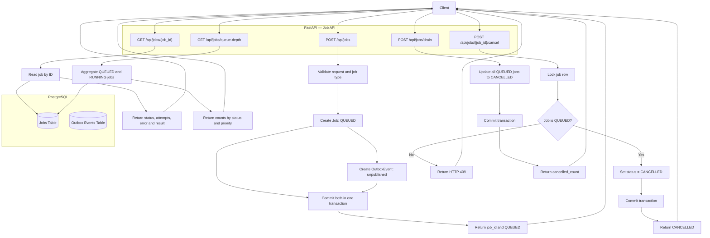
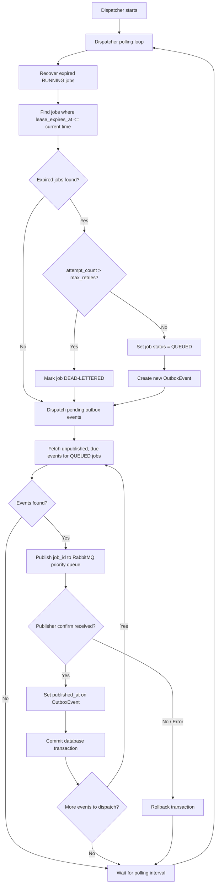

## Architecture

### 1. Job API — Submission and Management

The Job API accepts jobs, persists job and outbox records
atomically, and exposes operational endpoints.

### 2. Dispatcher — Recovery and Message Publishing

The dispatcher runs in a polling loop and performs two responsibilities:

- Recovers jobs whose worker leases have expired.
- Publishes due, unpublished outbox events to the RabbitMQ priority queue.

